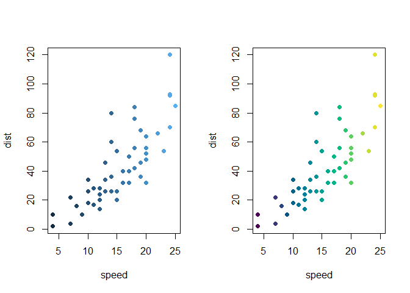
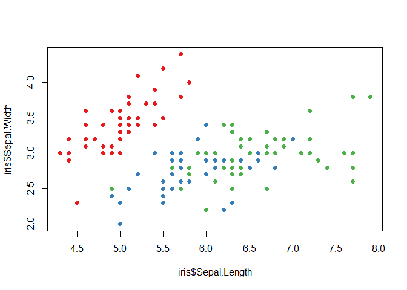
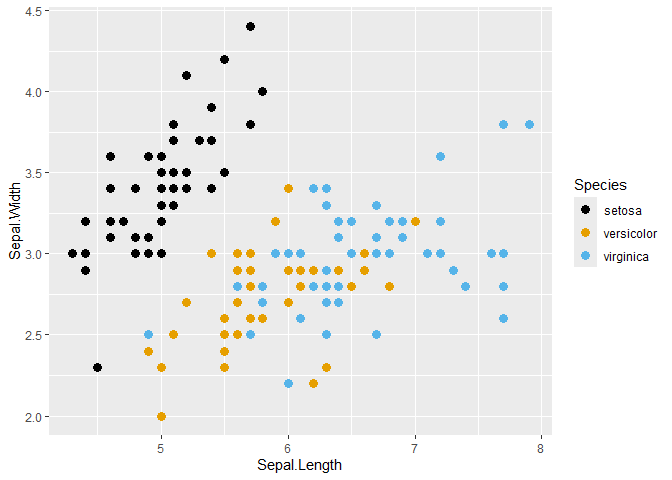
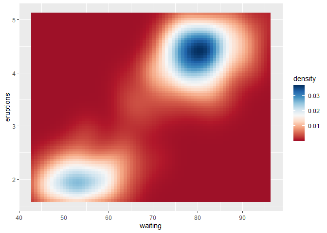

<!-- README.md is generated from README.Rmd. Please edit that file -->

# colortheme

<!-- badges: start -->

[](https://lifecycle.r-lib.org/articles/stages.html#experimental)
[](https://github.com/ryo-asashi/colortheme/actions/workflows/R-CMD-check.yaml)
<!-- badges: end -->

**colortheme** is a lightweight R package providing a unified interface
for managing, customizing, and applying qualitative, sequential, and
diverging color themes.

It acts as a versatile bridge between base R graphics, custom color
definitions, and popular palette collections (**grDevices**,
**viridisLite**, **RColorBrewer**, **khroma**, etc.), while offering
seamless scale integration for **ggplot2**.

## Features

1.  Unified Dispatcher (`colortheme()`): Effortlessly retrieve
    registered themes by name, build themes from color vectors or
    functions, or modify existing themes on the fly.
2.  Compact URL-Like Query Syntax: Customize themes instantly using
    query strings (e.g., reversing order with `_r`, specifying types
    with `@qual`, or adjusting transparency and missing-value colors
    with `?alpha=0.5;na.color='gray'`).
3.  Dual Functional Interface: Extract discrete palette functions
    (`$palette(n)`) or continuous color ramp functions (`$ramp(x)`) from
    any theme.
4.  Base R Data Mapping (`map_to_colors()`): Directly map discrete or
    continuous vectors into hexadecimal color codes for base R plots.
5.  Seamless **ggplot2** Scales: Automatically apply discrete or
    continuous scales using `scale_color_theme()` and
    `scale_fill_theme()`, complete with proper midpoint handling for
    diverging palettes.

## Installation

You can install the development version from GitHub:

``` r
# install.packages("pak")
pak::pak("ryo-asashi/colortheme")
```

## Quick Start & Core Concepts

### 1. Retrieving and Modifying Themes

`colortheme()` serves as the central interface. You can load pre-defined
palettes or apply the compact query syntax to reverse colors, change
types, or inject options.

``` r
library(colortheme)

# Retrieve a built-in sequential theme and generate colors
ct <- colortheme("Viridis")
ct$palette(5L)
#> [1] "#4B0055" "#00588B" "#009B95" "#53CC67" "#FDE333"
ct$ramp(seq.int(0, 1, length.out = 5))
#> [1] "#4B0054" "#00578A" "#009B94" "#53CC66" "#FDE333"

# Use URL-like query syntax for on-the-fly modifications
ct_custom <- colortheme("grDevices/Zissou 1_r@qual?alpha=0.75")
ct_custom$palette(4L)
#> [1] "#F5191CBF" "#E8A419BF" "#9FC095BF" "#3B99B1BF"
```

### 2. Extracting Palette and Ramp Functions

Using `as_palette()` and `as_ramp()`, you can easily extract clean
color-generating functions for custom graphics workflows.

``` r
# Extract a discrete palette function taking n
pal <- as_palette("Okabe-Ito")
pal(6L)
#> [1] "#000000" "#E69F00" "#56B4E9" "#009E73" "#F0E442" "#0072B2"

# Extract a continuous ramp function taking x in [0, 1]
ramp <- as_ramp("bluescale")
ramp(c(0, 0.5, 1.0))
#> [1] "#132B43" "#326A97" "#55B1F7"
```

### 3. Direct Mapping for Base R Graphics (`map_to_colors()`)

`map_to_colors()` automatically handles factor/character variables
(qualitative) and numeric vectors (sequential/diverging) with proper
scaling and `NA` management.

``` r
# Continuous mapping (Sequential)
plot(cars, col = map_to_colors(cars$speed, "Viridis"), pch = 19)
```



``` r

# Discrete mapping (Qualitative)
plot(iris$Sepal.Length, iris$Sepal.Width,
     col = map_to_colors(iris$Species, "Set 1"), pch = 19)
```



### 4. Integration with **ggplot2**

`scale_color_theme()` automatically detects whether the theme is
qualitative or continuous, configuring appropriate **ggplot2** scales
under the hood. Diverging themes automatically leverage
`scales::rescale_mid()` when a midpoint is specified.

``` r
library(ggplot2)

# Qualitative scale
ggplot(iris, aes(Sepal.Length, Sepal.Width, colour = Species)) +
  geom_point() +
  scale_color_theme("Set 1")
```



``` r

# Continuous diverging scale with custom midpoint
ggplot(faithfuld, aes(waiting, eruptions, fill = density)) +
  geom_tile() +
  scale_fill_theme("RdBu", middle = 0.017)
```



## Function Reference

- **Theme Construction & Modification**: `colortheme()`, `as_palette()`,
  `as_ramp()`
- **Registry & Discovery**: `colorthemes()`, `register_colortheme()`
- **Base R Mapping**: `map_to_colors()`
- **ggplot2 Scales**: `scale_color_theme()`, `scale_colour_theme()`,
  `scale_fill_theme()`
