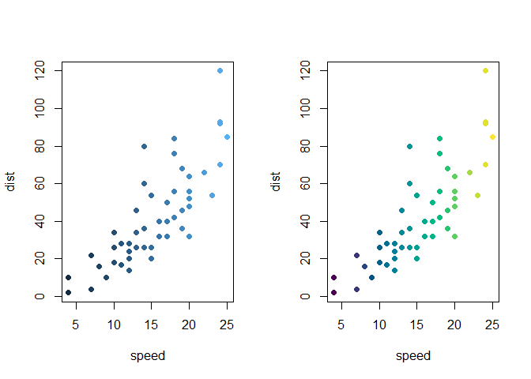
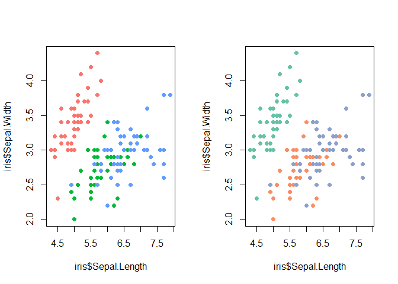
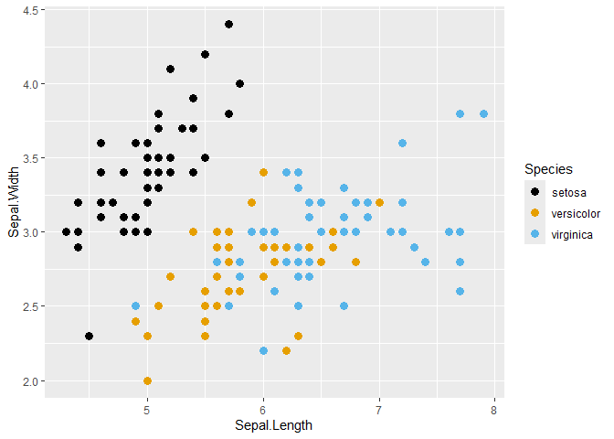
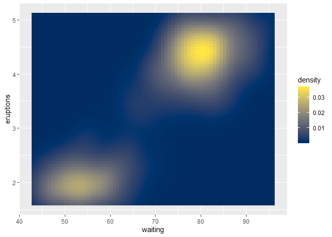

# colortheme

**colortheme** is a lightweight R package providing a unified interface
for managing, customizing, and applying qualitative, sequential, and
diverging color themes.

It acts as a versatile bridge between base R graphics, custom color
definitions, and popular palette collections (**grDevices**,
**viridisLite**, **RColorBrewer**, **khroma**, etc.), while offering
seamless scale integration for **ggplot2**.

## Features

1.  Unified Dispatcher
    ([`colortheme()`](https://ryo-asashi.github.io/colortheme/reference/colortheme.md)):
    Effortlessly retrieve registered themes by name, build themes from
    color vectors or functions, or modify existing themes on the fly.
2.  Compact Query Syntax: Customize themes instantly using query strings
    (e.g., reversing order with `_r`, specifying types with `@qual`, or
    adjusting transparency and missing-value colors with
    `?alpha=0.5;na.color='gray'`).
3.  Dual Functional Interface: Extract discrete palette functions
    (`$palette(n)`) or continuous color ramp functions (`$ramp(x)`) from
    any theme.
4.  Base R Data Mapping
    ([`map_to_colors()`](https://ryo-asashi.github.io/colortheme/reference/map_to_colors.md)):
    Directly map discrete or continuous vectors into hexadecimal color
    codes for base R plots.
5.  Seamless **ggplot2** Scales: Automatically apply discrete or
    continuous scales using
    [`scale_color_theme()`](https://ryo-asashi.github.io/colortheme/reference/scale_color_theme.md)
    and
    [`scale_fill_theme()`](https://ryo-asashi.github.io/colortheme/reference/scale_color_theme.md),
    complete with proper midpoint handling for diverging palettes.

## Installation

You can install the development version from GitHub:

``` r

# install.packages("pak")
pak::pak("ryo-asashi/colortheme")
```

## Quick Start & Core Concepts

### 1. Discovering and Retrieving Themes

[`colorthemes()`](https://ryo-asashi.github.io/colortheme/reference/colorthemes.md)
helps to find a color theme. You can filter the registry by name,
source, or type using case-insensitive prefix matching.

``` r

library(colortheme)

# Find color themes matching "ma"
colorthemes("ma")
#>      name      source       type
#> 1 managua      khroma  diverging
#> 2 Magenta   grDevices sequential
#> 3   magma viridisLite sequential
#> 4    mako viridisLite sequential
#> 5    Mako   grDevices sequential

# Find color themes from a specific source
colorthemes(source = "grDevices") |> head(5)
#>         name    source      type
#> 1   ArmyRose grDevices diverging
#> 2     Berlin grDevices diverging
#> 3   Blue-Red grDevices diverging
#> 4 Blue-Red 2 grDevices diverging
#> 5 Blue-Red 3 grDevices diverging
```

Once you find a theme,
[`colortheme()`](https://ryo-asashi.github.io/colortheme/reference/colortheme.md)
serves as the central interface to load and use it. You can retrieve
pre-defined palettes or apply the compact query syntax to reverse
colors, change types, or inject options.

``` r

library(colortheme)

# Retrieve a built-in sequential theme and generate colors
ct <- colortheme("Viridis")
ct$palette(5L)
#> [1] "#4B0055" "#00588B" "#009B95" "#53CC67" "#FDE333"
ct$ramp(seq.int(0, 1, length.out = 5))
#> [1] "#4B0054" "#00578A" "#009B94" "#53CC66" "#FDE333"

# Use query syntax for on-the-fly modifications
ct_custom <- colortheme("grDevices/Zissou 1_r@qual?alpha=0.75")
ct_custom$palette(4L)
#> [1] "#F5191CBF" "#E8A419BF" "#9FC095BF" "#3B99B1BF"
```

### 2. Extracting Palette and Ramp Functions

Using
[`as_palette()`](https://ryo-asashi.github.io/colortheme/reference/as_palette.md)
and
[`as_ramp()`](https://ryo-asashi.github.io/colortheme/reference/as_palette.md),
you can easily extract clean color-generating functions for custom
graphics workflows.

``` r

# Extract a discrete palette function taking n
pal <- as_palette("Okabe-Ito")
pal(6L)
#> [1] "#000000" "#E69F00" "#56B4E9" "#009E73" "#F0E442" "#0072B2"

# Extract a continuous ramp function taking x in [0, 1]
ramp <- as_ramp("bluescale")
ramp(c(0, 0.5, 1.0))
#> [1] "#132B43" "#326A97" "#55B1F7"
```

### 3. Direct Mapping for Base R Graphics (`map_to_colors()`)

[`map_to_colors()`](https://ryo-asashi.github.io/colortheme/reference/map_to_colors.md)
automatically handles factor/character variables (qualitative) and
numeric vectors (sequential/diverging) with proper scaling and `NA`
management.

``` r

# Continuous mapping (Sequential)
par(mfrow = c(1L, 2L))
plot(cars, col = map_to_colors(cars$speed), pch = 19)
plot(cars, col = map_to_colors(cars$speed, "Viridis"), pch = 19)
```



``` r


# Discrete mapping (Qualitative)
plot(iris$Sepal.Length, iris$Sepal.Width,
     col = map_to_colors(iris$Species), pch = 19)
plot(iris$Sepal.Length, iris$Sepal.Width,
     col = map_to_colors(iris$Species, "Set 2"), pch = 19)
```



### 4. Integration with **ggplot2**

[`scale_color_theme()`](https://ryo-asashi.github.io/colortheme/reference/scale_color_theme.md)
automatically detects whether the theme is qualitative or continuous,
configuring appropriate **ggplot2** scales under the hood. Diverging
themes automatically leverage
[`scales::rescale_mid()`](https://scales.r-lib.org/reference/rescale_mid.html)
when a midpoint is specified.

``` r

library(ggplot2)

# Qualitative scale
ggplot(iris, aes(Sepal.Length, Sepal.Width, colour = Species)) +
  geom_point(size = 3) +
  scale_color_theme("Okabe-Ito")
```



``` r


# Continuous diverging scale with custom midpoint
ggplot(faithfuld, aes(waiting, eruptions, fill = density)) +
  geom_tile() +
  scale_fill_theme("Cividis", middle = 0.017)
```



## Function Reference

- **Theme Construction & Modification**:
  [`colortheme()`](https://ryo-asashi.github.io/colortheme/reference/colortheme.md),
  [`as_palette()`](https://ryo-asashi.github.io/colortheme/reference/as_palette.md),
  [`as_ramp()`](https://ryo-asashi.github.io/colortheme/reference/as_palette.md)
- **Registry & Discovery**:
  [`colorthemes()`](https://ryo-asashi.github.io/colortheme/reference/colorthemes.md),
  [`register_colortheme()`](https://ryo-asashi.github.io/colortheme/reference/colorthemes.md)
- **Base R Mapping**:
  [`map_to_colors()`](https://ryo-asashi.github.io/colortheme/reference/map_to_colors.md)
- **ggplot2 Scales**:
  [`scale_color_theme()`](https://ryo-asashi.github.io/colortheme/reference/scale_color_theme.md),
  [`scale_colour_theme()`](https://ryo-asashi.github.io/colortheme/reference/scale_color_theme.md),
  [`scale_fill_theme()`](https://ryo-asashi.github.io/colortheme/reference/scale_color_theme.md)
